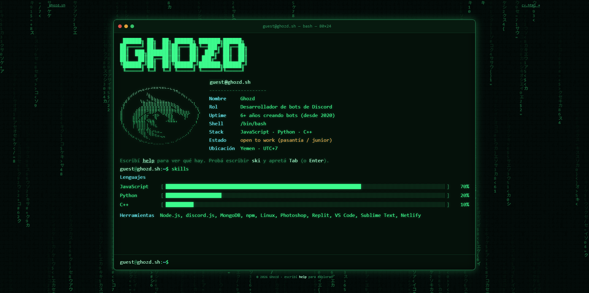
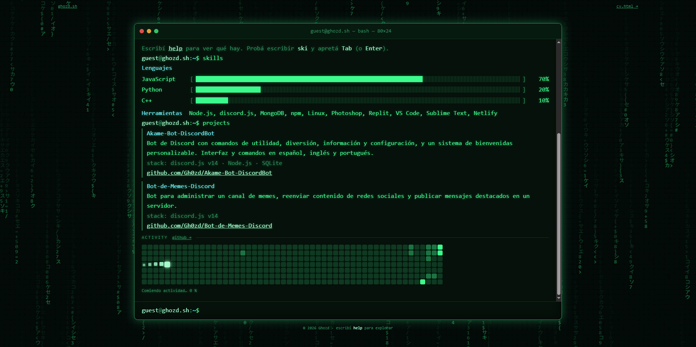
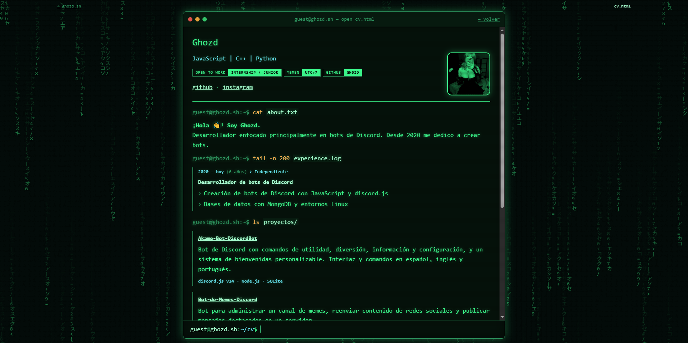
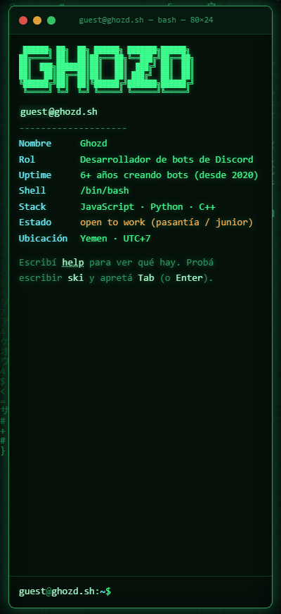
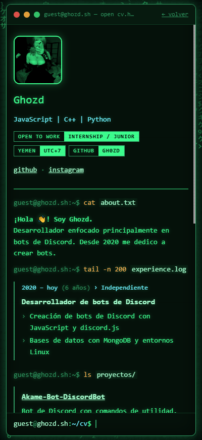
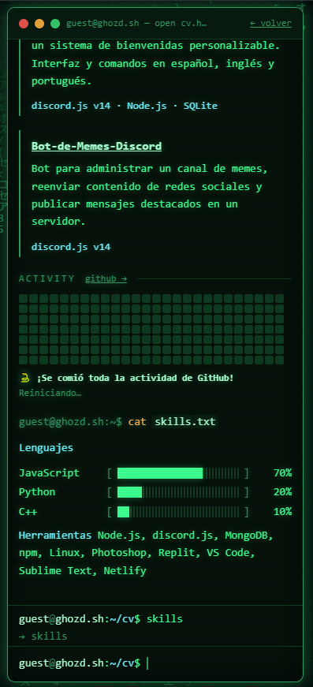

<div align="center">


<strong>Portafolio personal interactivo con una terminal simulada y una vista de currículum. Presenta proyectos, habilidades y datos de contacto sin dependencias ni proceso de compilación.</strong>

</div>

---

## Características

* **Terminal interactiva:** explora el portafolio mediante comandos, autocompletado e historial.
* **Currículum integrado:** cambia entre la terminal y la vista de CV con navegación por hash.
* **Contenido centralizado:** los datos personales, proyectos, experiencia y habilidades se configuran en un solo archivo.
* **Personalización visual:** incluye temas de color, efectos de inicio y animación de lluvia de código.
* **Actividad de GitHub:** muestra un gráfico de contribuciones con una animación de serpiente; utiliza datos de ejemplo si el servicio externo no está disponible.
* **Diseño adaptable:** ajusta la interfaz a pantallas móviles y de escritorio.

## Requisitos

* Un navegador moderno compatible con CSS nesting, `color-mix()` y campos privados de clases de JavaScript.
* Conexión a Internet opcional para cargar datos de actividad de GitHub.
* No requiere Node.js, instalación de paquetes ni compilación.

## Instalación e inicio rápido

1. Clona el repositorio:

   ```bash
   git clone https://github.com/Gh0zd/portafolio-terminal.git
   ```

2. Abre `index.html` en un navegador moderno.
3. Escribe `help` en la terminal para consultar los comandos disponibles.

También puedes publicar la carpeta del proyecto en un servicio de alojamiento para sitios estáticos.

## Configuración

| Archivo o elemento | Uso |
| --- | --- |
| `js/data.js` | Edita nombre, perfil, experiencia, proyectos, habilidades, herramientas y contacto. |
| `img/avatar.png` | Imagen de perfil. También se prueban los formatos `.jpg`, `.jpeg` y `.webp`; si no hay imagen, se muestran las iniciales. |
| `js/art.js` | Personaliza el logo y el retrato generado en Braille. |
| `index.html` | Para cambiar el cursor a bloque, añade `data-cursor="block"` a la etiqueta `<html>`. |

No se requieren variables de entorno ni archivos `.env`.

## Comandos

| Consola | Comandos |
| --- | --- |
| Terminal | `help`, `about`, `skills`, `projects`, `contact`, `cv`, `home`, `theme`, `clear`, `history`, `exit`. También incluye comandos ocultos como `ls`, `cat <proyecto>`, `neofetch` y `banner`. |
| Consola del CV | `home`, `about`, `experience`, `projects`, `activity`, `skills`, `contact`, `top`, `theme`, `clear`, `history`. |
| Atajos | `Tab` o `→` autocompletan; `↑` y `↓` recorren el historial; `Ctrl+L` limpia la consola. Cualquier tecla revela de inmediato el texto que se está escribiendo. |

## Capturas

<p align="center">
  
  
  
</p>

<p align="center">
  
  
  
</p>

## Estructura del proyecto

```text
.
├── index.html             # Estructura de la terminal y del CV
├── css/
│   ├── tokens.css          # Colores, temas y cursor
│   ├── base.css            # Estilos base y ventana
│   ├── terminal.css        # Terminal, salida y prompt
│   ├── components.css      # Componentes, lenguajes y actividad
│   └── cv.css              # Vista del currículum
├── js/
│   ├── data.js             # Datos editables del portafolio
│   ├── utils.js            # Utilidades, temas y preferencias
│   ├── art.js              # Logo y retrato en Braille
│   ├── views.js            # Constructores de contenido compartidos
│   ├── terminal.js         # Motor de consola, salida y prompt
│   ├── commands.js         # Comandos de terminal y del CV
│   ├── activity.js         # Actividad de GitHub y animación
│   ├── cv.js               # Generación de la vista del CV
│   ├── effects.js          # Secuencia de inicio y efectos visuales
│   └── app.js              # Entrada y navegación entre vistas
├── docs/
│   └── screenshot/         # Capturas de escritorio y móviles
└── img/
    └── avatar.png          # Imagen de perfil
```
